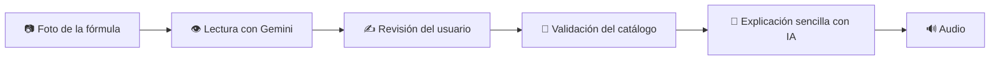

# MedVoz

> Convierte una fórmula médica fotografiada en una explicación clara, sencilla y fácil de escuchar.

MedVoz es una aplicación web académica que utiliza inteligencia artificial para leer fórmulas médicas a partir de una imagen. Extrae medicamentos e indicaciones, permite que la persona revise la lectura, valida los productos mediante un catálogo y genera una explicación en español sencillo.

## Estado del proyecto

| Área                            | Estado                              |
| ------------------------------- | ----------------------------------- |
| Lectura de fórmulas con Gemini  | ✅ Funcional                        |
| Confirmación y edición de datos | ✅ Funcional                        |
| Catálogo PostgreSQL             | ✅ Funcional                        |
| Validación con RxNorm/openFDA   | ✅ Integrada                        |
| Explicación estructurada con IA | ✅ Funcional                        |
| Audio                           | ⚠️ Pendiente de ajuste/prueba final |

## Flujo de la aplicación



La aplicación no genera imágenes. La imagen subida se procesa temporalmente para leer el contenido; después, la explicación se genera usando los datos estructurados y confirmados.

## Funcionalidades principales

- Lectura de imágenes JPEG, PNG, WebP y HEIC.
- Extracción de nombre, presentación, dosis, frecuencia, duración, vía e instrucciones.
- Revisión y edición manual antes de continuar.
- Validación contra un catálogo local de medicamentos y productos nutricionales.
- Respaldo de validación mediante RxNorm y openFDA.
- Explicaciones estructuradas con advertencias y preguntas para consultar al profesional de salud.
- Disclaimer médico agregado por el backend.
- Audio mediante OpenAI TTS o voz del navegador como fallback.
- Procesamiento temporal de imágenes, sin guardar fórmulas en `localStorage` ni en archivos.

## Arquitectura

```text
MedVoz/
├── apps/
│   ├── api/              # API Express, IA, validación y TTS
│   └── web/              # Interfaz React + Vite
├── packages/shared/      # Tipos y esquemas Zod compartidos
├── prisma/               # Esquema y migraciones PostgreSQL
├── data/drugs.csv        # Catálogo inicial
└── e2e/                  # Pruebas de recorrido con Playwright
```

### Servicios externos

| Servicio            | Uso                               | Configuración     |
| ------------------- | --------------------------------- | ----------------- |
| Google Gemini       | Lectura de imágenes y explicación | `GEMINI_API_KEY`  |
| PostgreSQL + Prisma | Catálogo y métricas anónimas      | `DATABASE_URL`    |
| RxNorm              | Validación de respaldo            | No requiere clave |
| openFDA             | Validación de respaldo            | No requiere clave |
| OpenAI TTS          | Audio cloud opcional              | `TTS_API_KEY`     |

## Requisitos

- Node.js 20 o superior.
- pnpm 9 o superior.
- Docker, para PostgreSQL local.

## Instalación rápida

```bash
pnpm install
cp .env.example .env
```

Configura los proveedores en `.env` sin subir ese archivo al repositorio. Como mínimo, configura el proveedor LLM y su clave en tu entorno local.

Inicializa la base de datos y el catálogo:

```bash
docker compose up -d postgres
pnpm db:generate
pnpm db:push
pnpm seed:catalog
```

Inicia la aplicación:

```bash
pnpm dev
```

URLs locales:

- Web: <http://localhost:5173>
- API: <http://localhost:3001>
- Health check: <http://localhost:3001/health>

## Configuración de audio

Por defecto, el proyecto usa la voz del navegador:

```env
TTS_PROVIDER=browser
```

Para usar audio generado en backend:

```env
TTS_PROVIDER=openai
TTS_API_KEY=tu_clave_de_openai
```

El audio cloud continúa pendiente de una prueba final. Si no está disponible, la interfaz intenta usar `speechSynthesis` del navegador.

## Endpoints principales

| Método | Endpoint                      | Descripción                             |
| ------ | ----------------------------- | --------------------------------------- |
| `GET`  | `/health`                     | Estado de la API y proveedor LLM activo |
| `POST` | `/api/prescriptions/extract`  | Lee una imagen de fórmula               |
| `POST` | `/api/prescriptions/validate` | Valida los productos detectados         |
| `POST` | `/api/prescriptions/explain`  | Genera la explicación estructurada      |
| `POST` | `/api/tts`                    | Genera audio cuando se usa TTS cloud    |

## Pruebas y calidad

```bash
pnpm typecheck
pnpm lint
pnpm test
pnpm build
pnpm e2e
```

También puedes comprobar la conexión real con Gemini:

```bash
pnpm llm:check
```

## Privacidad y seguridad

- Las claves viven únicamente en el backend y en `.env`.
- `.env` está excluido por `.gitignore`.
- Las imágenes se procesan en memoria y no se guardan en disco.
- La interfaz solicita consentimiento antes de enviar una imagen a un proveedor externo.
- El backend limita el tamaño de imagen, aplica rate limiting y valida las respuestas con Zod.
- La explicación incluye un aviso que indica que no reemplaza al médico o farmacéutico.

> MedVoz es un prototipo académico. No diagnostica ni sustituye la valoración de un profesional de la salud.

## Próximos pasos

1. Terminar y probar el flujo de voz en navegador y TTS cloud.
2. Mejorar la validación de productos nutricionales y medicamentos regionales.
3. Añadir pruebas e2e con la API real en modo controlado.
4. Preparar despliegue y gestión segura de secretos.
