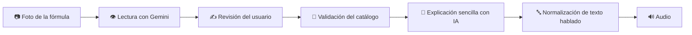

# MedVoz

> Convierte una fórmula médica fotografiada en una explicación clara, sencilla y fácil de escuchar.

MedVoz es una aplicación web académica que utiliza inteligencia artificial para leer fórmulas médicas a partir de una imagen. Extrae medicamentos e indicaciones, permite que la persona revise la lectura, valida los productos mediante un catálogo y genera una explicación en español sencillo, con audio.

> ⚠️ **MedVoz es un prototipo académico de apoyo.** No diagnostica, no receta y no reemplaza al médico ni al farmacéutico. Sigue siempre las indicaciones de tu fórmula médica y consulta a un profesional ante cualquier duda.

## Estado del proyecto

| Área                                         | Estado                                   |
| -------------------------------------------- | ---------------------------------------- |
| Lectura de fórmulas con Gemini               | ✅ Funcional                             |
| Confirmación y edición de datos              | ✅ Funcional                             |
| Catálogo PostgreSQL                          | ✅ Funcional                             |
| Validación con RxNorm/openFDA                | ✅ Integrada                             |
| Explicación estructurada con IA              | ✅ Funcional                             |
| Audio (Gemini TTS, OpenAI TTS y voz nativa)  | ✅ Funcional                             |
| Lectura correcta de dosis y unidades (mg, ml)| ✅ Normalizador de texto hablado         |
| Rediseño de interfaz y accesibilidad         | ✅ Implementado                          |
| Guía enriquecida (qué hace cada medicamento) | 🚧 En progreso                           |
| Glosario de abreviaturas de fórmulas         | 🚧 En progreso                           |

## Flujo de la aplicación



La aplicación no genera imágenes. La imagen subida se procesa temporalmente para leer el contenido; después, la explicación se genera usando los datos estructurados y confirmados.

## Funcionalidades principales

- Lectura de imágenes JPEG, PNG, WebP y HEIC.
- Extracción de nombre, presentación, dosis, frecuencia, duración, vía e instrucciones.
- Revisión y edición manual antes de continuar.
- Validación contra un catálogo local de medicamentos y productos nutricionales.
- Respaldo de validación mediante RxNorm y openFDA.
- Explicaciones estructuradas con advertencias y preguntas para consultar al profesional de salud.
- Disclaimer médico agregado por el backend.
- **Audio** con tres fuentes: Gemini TTS, OpenAI TTS o voz del navegador como respaldo automático.
- **Lectura correcta de unidades:** un normalizador convierte `500 mg`, `0,5 mg`, `1.000 mg` o `250 mg/5 ml` a palabras en español antes de pasar el texto al motor de voz.
- Reproductor con play/pause, progreso, velocidad (0.8x, 1x, 1.2x) y selector de fuente.
- Procesamiento temporal de imágenes, sin guardar fórmulas en `localStorage` ni en archivos.

## Interfaz y accesibilidad

Estilo visual **"Clinical Clarity & Warmth"**: salud digital moderna, empática y sin estrés.

- Paleta con tokens de diseño: teal clínico, azul sanitario suave, verde para elementos verificados y ámbar para advertencias. Nunca se comunica un estado solo con color: siempre va acompañado de icono y texto.
- Modo claro y oscuro, y selector de tamaño de texto (A- / A+). Estas preferencias de interfaz son lo único que se recuerda en el navegador; nunca datos de fórmulas.
- Vistas: inicio y subida, visor con edición de medicamentos (pantalla dividida) y resultado con reproductor, cronograma de dosis y tarjetas expandibles por medicamento.
- Navegación completa con teclado, foco visible, etiquetas ARIA y contraste AA.

## Arquitectura

```text
MedVoz/
├── apps/
│   ├── api/              # API Express, IA, validación y TTS
│   └── web/              # Interfaz React + Vite
├── packages/shared/      # Tipos, esquemas Zod y utilidades compartidas
│   └── src/spokenText.ts # Normalizador de texto hablado (mg, ml, decimales)
├── prisma/               # Esquema y migraciones PostgreSQL
├── data/drugs.csv        # Catálogo inicial
└── e2e/                  # Pruebas de recorrido con Playwright
```

### Servicios externos

| Servicio            | Uso                                          | Configuración                      |
| ------------------- | -------------------------------------------- | ---------------------------------- |
| Google Gemini       | Lectura de imágenes, explicación y audio     | `GEMINI_API_KEY`                   |
| PostgreSQL + Prisma | Catálogo y métricas anónimas                 | `DATABASE_URL`                     |
| RxNorm              | Validación de respaldo                       | No requiere clave                  |
| openFDA             | Validación de respaldo                       | No requiere clave                  |
| OpenAI TTS          | Audio cloud opcional                         | `TTS_API_KEY`                      |

## Requisitos

- Node.js 20 o superior.
- pnpm 9 o superior.
- Docker, para PostgreSQL local.

## Instalación rápida

```bash
pnpm install
cp .env.example .env
```

Configura los proveedores en `.env` sin subir ese archivo al repositorio. Como mínimo, configura el proveedor LLM y su clave en tu entorno local.

Inicializa la base de datos y el catálogo:

```bash
docker compose up -d postgres
pnpm db:generate
pnpm db:push
pnpm seed:catalog
```

Inicia la aplicación:

```bash
pnpm dev
```

URLs locales:

- Web: <http://localhost:5173>
- API: <http://localhost:3001>
- Health check: <http://localhost:3001/health>

## Configuración de audio

El proveedor se elige con `TTS_PROVIDER`:

| Valor     | Descripción                                                        |
| --------- | ------------------------------------------------------------------ |
| `browser` | Voz nativa del navegador (`speechSynthesis`). Valor por defecto.   |
| `gemini`  | Gemini TTS desde el backend. Reutiliza `GEMINI_API_KEY`.           |
| `openai`  | OpenAI TTS desde el backend. Requiere `TTS_API_KEY`.               |

Ejemplo con Gemini TTS:

```env
TTS_PROVIDER=gemini
TTS_MODEL=gemini-3.8-flash-lite-tts
TTS_VOICE=Kore
```

> Los nombres de modelos de TTS cambian con frecuencia: confirma el vigente en la documentación oficial de Gemini API antes de desplegar. El modelo es configurable por variable de entorno.

Ejemplo con OpenAI:

```env
TTS_PROVIDER=openai
TTS_API_KEY=tu_clave_de_openai
```

**Cómo se lee el texto:** antes de enviarse a cualquier proveedor (y también en el respaldo del navegador), el texto pasa por `toSpokenText`, que convierte unidades, decimales y abreviaturas de posología a palabras (`0,5 mg` → "cero coma cinco miligramos"; `c/8h` → "cada 8 horas"). Si el audio cloud falla, la interfaz cambia automáticamente a la voz del navegador.

> **Limitación conocida:** un valor con punto decimal y tres decimales (por ejemplo `0.125`) es ambiguo frente al separador de miles. Siempre que sea posible, la dosis viaja como campos estructurados (valor y unidad) y no como texto libre.

## Endpoints principales

| Método | Endpoint                      | Descripción                                   |
| ------ | ----------------------------- | --------------------------------------------- |
| `GET`  | `/health`                     | Estado de la API y proveedor LLM activo       |
| `POST` | `/api/prescriptions/extract`  | Lee una imagen de fórmula                     |
| `POST` | `/api/prescriptions/validate` | Valida los productos detectados               |
| `POST` | `/api/prescriptions/explain`  | Genera la explicación estructurada            |
| `POST` | `/api/tts`                    | Genera audio (WAV) con el proveedor elegido   |

## Pruebas y calidad

```bash
pnpm typecheck
pnpm lint
pnpm test
pnpm build
pnpm e2e
```

También puedes comprobar la conexión real con Gemini:

```bash
pnpm llm:check
```

## Privacidad y seguridad

- Las claves viven únicamente en el backend y en `.env`.
- `.env` está excluido por `.gitignore`.
- Las imágenes se procesan en memoria y no se guardan en disco.
- La interfaz solicita consentimiento antes de enviar una imagen a un proveedor externo.
- El backend limita el tamaño de imagen, aplica rate limiting y valida las respuestas con Zod.
- La explicación incluye un aviso que indica que no reemplaza al médico o farmacéutico.
- El texto que se lee en voz alta para la dosis y la frecuencia se arma a partir de datos confirmados por el usuario, no de redacción libre del modelo.

> MedVoz es un prototipo académico. No diagnostica ni sustituye la valoración de un profesional de la salud.

## Próximos pasos

1. **Guía más útil:** explicar en lenguaje sencillo qué es cada medicamento y para qué suele usarse, con precauciones y preguntas para el médico, evitando el texto genérico de respaldo repetido.
2. **Glosario de abreviaturas** de fórmulas colombianas (`GR`, `CC`, `SSN IV`, `PARA DIL`), marcando como "confirmar" las que sean ambiguas (por ejemplo `SC` o "24 Horas").
3. **Catálogo con información general curada** y revisión por un profesional de la salud antes de cualquier uso real.
4. Mejorar la validación de productos nutricionales y medicamentos regionales.
5. Añadir pruebas e2e con la API real en modo controlado.
6. Preparar despliegue y gestión segura de secretos.
